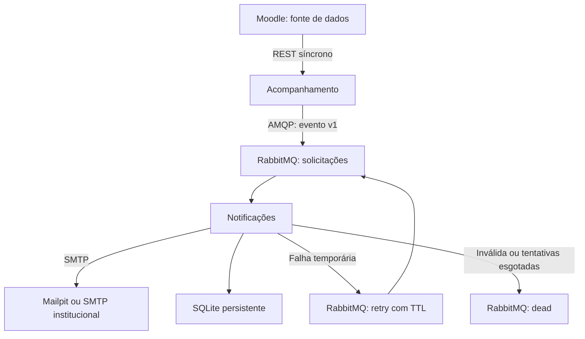
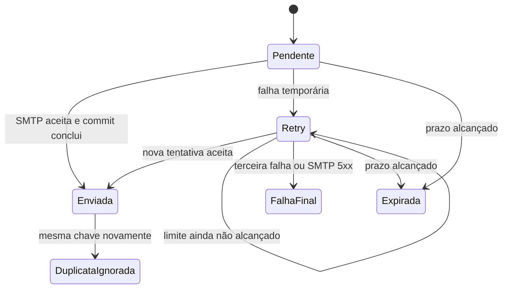

# Arquitetura e decisões

O monólito Moodle continua sendo a fonte de matrículas, atividades e entregas. Os microsserviços não alteram o Moodle.
O acompanhamento decide **quem deve receber**; as notificações decidem **como enviar e registrar o resultado**.

## Por que cada escolha

| Decisão | Motivo e consequência |
| --- | --- |
| Python 3.12 e biblioteca padrão | Base simples para HTTP, SQLite, SMTP e testes do domínio; apenas Pika em produção |
| Pika 1.3.2 | Cliente AMQP fixado na API utilizada; upgrade requer executar a suíte |
| Dois processos e imagens de aplicação | Permitem reiniciar o consumidor sem interromper a consulta ao Moodle |
| RabbitMQ durável e mensagens persistentes | Conservam solicitações entre reinícios normais do broker com o volume preservado |
| Publisher confirms + mandatory | Publicação somente é considerada aceita depois da confirmação; mensagem sem rota gera erro |
| ACK manual e prefetch 1 | Cada entrega só é confirmada após processamento ou encaminhamento confirmado |
| Retry com TTL + DLX | A espera acontece no broker; o processo não bloqueia dormindo dentro do callback |
| Tentativas persistidas no SQLite | Repetições da mesma mensagem não reiniciam o orçamento de tentativas |
| SQLite com UNIQUE, WAL e synchronous FULL | Histórico local persistente e transação simples para um consumidor |
| BEGIN IMMEDIATE durante o SMTP | Serializa consumidores que compartilham o mesmo arquivo local; limita vazão e não elimina a janela SMTP/commit |
| Sem interface própria | Mantém o escopo; as telas administrativas pertencem ao RabbitMQ e ao Mailpit |
| Quarta função Moodle para conteúdo | A resposta de tarefas da versão consultada não oferece visibilidade suficiente; evita confiar no acesso do usuário técnico a atividades ocultas |

## Contrato

`infra/events.py` define a versão 1. Os campos são IDs de curso/tarefa/aluno, nome e e-mail do estudante,
nome da tarefa, `due_at`, `assignment_url`, `created_at`, `schema_version` e `event_id`.
A chave é recalculada no consumidor; não é aceita uma chave incompatível com os IDs.
Timestamps usam segundos Unix. Mensagens maiores que 32 KiB ou fora do contrato vão para `.dead`.
Um exemplo real gerado nos testes está em `evidencias/evento_exemplo.json`.

## Estados de entrega

O banco contém `deliveries` (estado atual) e `audit` (ocorrências). Os logs JSON contêm chave e tipo de erro,
sem corpo do e-mail, nome, endereço ou token. SQLite não armazena nome ou e-mail; a fila contém esses campos
para o envio, portanto seu acesso deve seguir a política do ambiente.

## Falhas e recuperação

- Erro HTTP transitório: até três tentativas por chamada, esperas 1 e 2 segundos.
- Erro Moodle ou resposta parcial com warnings: o ciclo para antes de publicar.
- Falha AMQP de publicação: o próximo ciclo consulta novamente; possíveis mensagens repetidas são deduplicadas no destino.
- SMTP temporário: estado `retry`, publicação confirmada na fila retry, ACK da original e retorno após TTL.
- Falha ao publicar o retry: a original fica sem ACK e retorna após reconexão.
- SMTP 5xx ou terceira falha: estado `dead` e mensagem preservada na fila de falhas.
- Contrato inválido: preservado em `.dead`, sem tentativa SMTP.
- Reinício de processo: volume SQLite e filas RabbitMQ preservam o histórico e o trabalho pendente.

Fila retry é clássica e utiliza dead lettering padrão. Um cenário de indisponibilidade do destino exatamente
no encaminhamento por DLX exige atenção operacional; não foi demonstrada garantia de entrega ponta a ponta
durante falhas arbitrárias do broker. Em um ambiente de maior criticidade, avaliar quorum queues,
dead lettering com garantia de ao menos uma entrega e um outbox transacional.
